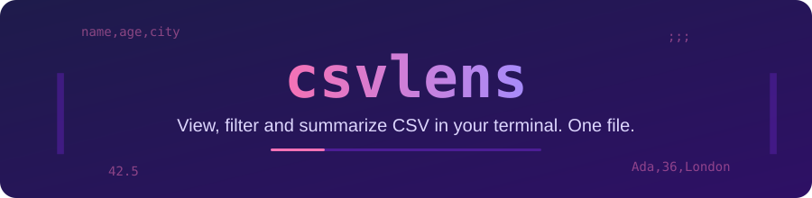

<p align="center">
  
</p>

<p align="center">
  
  
  
</p>

**csvlens** is a single Python file that lets you view, filter, sort and summarize CSV files right in your terminal.
No `pip install`, no dependencies. Download one file and run it.

<p align="center">
  
</p>

## Run

```bash
python csvlens.py data.csv
```

Or grab just the file:

```bash
curl -O https://raw.githubusercontent.com/ERROR404DTIR/csvlens/main/csvlens.py
```

## Options

| Option | What it does |
|---|---|
| `file` | CSV file. Reads `stdin` if omitted or `-` |
| `--cols a,b` | Show only these columns (names or 1-based numbers) |
| `-w, --where EXPR` | Filter rows, repeatable (AND). Operators: `=` `==` `!=` `>` `<` `>=` `<=` `~` (contains) `!~` |
| `-s, --sort COL[:desc]` | Sort by a column, numeric when possible |
| `-l, --limit N` | Rows to show (default 20, `0` = all) |
| `--stats` | Per-column summary: type, filled, unique, min/max/mean/median, top values |
| `--json` | Output the matching rows as JSON |

The delimiter (comma, semicolon, tab, pipe) is detected automatically.

## Examples

```bash
python csvlens.py sales.csv --where "amount>1000" --sort amount:desc
python csvlens.py users.csv --where "city~london" --cols name,email
python csvlens.py data.tsv --stats
python csvlens.py data.csv --where "status==ok" --json > ok.json
cat data.csv | python csvlens.py --limit 5
```

## Why

- **One file**, readable in a few minutes
- **Zero dependencies**: only the Python standard library
- **Safe**: read-only, never modifies your files
- Works on Windows, Linux and macOS

## License

MIT
